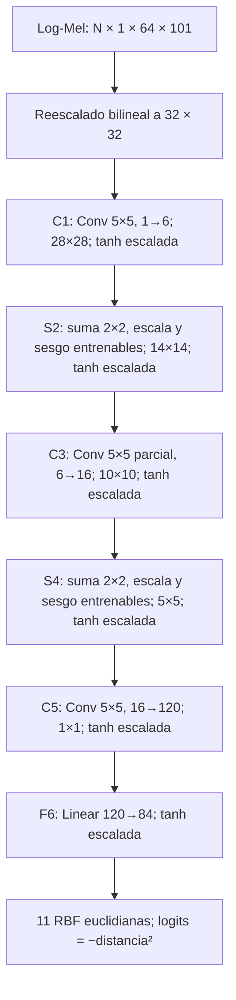
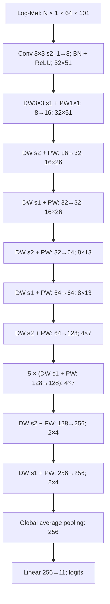

# Arquitecturas, datos y protocolo experimental

Ambas redes están escritas manualmente con `torch.nn` y operaciones de PyTorch.
No se usan torchvision, timm, Lightning, modelos preentrenados ni constructores
de arquitecturas externos. Se entrenan desde cero para las once clases del notebook.

## Modelo A: LeNet-5

Referencia: LeCun, Bottou, Bengio y Haffner (1998),
[Gradient-Based Learning Applied to Document Recognition](https://bottou.org/papers/lecun-98h),
DOI: 10.1109/5.726791, sección II y tabla I.

Se mantienen los anchos 6/16/120/84, kernels 5×5, conectividad parcial original de
C3 (1.516 parámetros), subsampling con escala y sesgo aprendibles y activación
`1.7159 tanh(2x/3)`. El núcleo suma **60.000 parámetros entrenables**.
La entrada log-Mel se interpola a 32×32, un canal, sin ejes ni color. Esto reduce
resolución temporal/espectral y debe discutirse como limitación de la adaptación.
La interpolación está dentro del forward para que ambas redes reciban el mismo
contrato de entrada `N×1×64×101`.

La salida conserva la distancia RBF de 84 componentes. El artículo usa códigos
fijos ±1 de glifos de dígitos: para audio se necesitan once códigos de palabras.
Se emplean códigos binarios distintos y reproducibles con semilla fija 1998,
guardados como buffers del checkpoint. **El cambio de diez glifos a once códigos
de audio se debe consultar al profesor antes de presentar esta adaptación como
aprobada.** Aquí se explicita la decisión para permitir esa revisión; no se
presupone aprobación. La pérdida discriminativa es cross-entropy sobre las
distancias negativas, no la función MAP específica del artículo. El enunciado
solicita definir la pérdida; reportar esta elección expresamente.

No se reemplazan subsampling por max pooling, C3 parcial por convolución densa,
tanh por ReLU ni RBF por una capa lineal. Si el profesor solicita una variante
didáctica distinta, documentar y aprobar sus cambios antes de compararla.

## Modelo B: MobileNetV1 α=0,25

Referencia: Howard et al. (2017),
[MobileNets: Efficient Convolutional Neural Networks for Mobile Vision Applications](https://arxiv.org/abs/1704.04861),
tabla 1. Se implementa el orden de los trece bloques separables del artículo y
su multiplicador de ancho. Los anchos reales son 8/16/32/64/128/256.

Cada DW es `Conv2d(groups=in_channels)`. Cada DW/PW usa batch normalization y
ReLU. La convolución inicial admite un canal; el clasificador admite once clases.
Para un kernel K×K, M entradas, N salidas y D posiciones, la convolución estándar
requiere aproximadamente `K²MND` MACs; una separable requiere `K²MD + MND`.
El ancho α reduce los términos de convoluciones puntuales aproximadamente como
α². Se conserva profundidad, se reduce ancho y se evita un clasificador denso
grande mediante pooling global. Esto motiva su uso móvil; menor costo teórico
no garantiza menor latencia en cada backend o dispositivo.

La menor capacidad puede limitar el ajuste y la generalización. BatchNorm y
weight decay ayudan a estabilizar/regularizar, pero las curvas y métricas por
clase deben sustentar las conclusiones. La selección final combina calidad y
medidas de eficiencia; probar ONNX en el teléfono es una etapa posterior.

## Datos base y aumentados

El notebook genera log-Mel 64×101×1 a partir de audio mono 16 kHz de un segundo.
Los tensores son float32 en [0,1]; no se vuelven a comprimir leyendo PNG.
Las dos variantes usan **exactamente los mismos IDs y particiones** de hablantes.
Base entrega el tensor original. Aumentado entrega una vista estocástica nueva
durante cada época: dos máscaras de frecuencia de ancho uniforme entre 0 y 8
bandas, y dos de tiempo de ancho entre 0 y 10 frames. El inicio es uniforme entre
posiciones válidas. Cero representa el piso espectral de −80 dB respecto al
máximo del clip. No se generan variantes aumentadas de validación o test.

Referencia: Park et al. (2019),
[SpecAugment: A Simple Data Augmentation Method for Automatic Speech Recognition](https://arxiv.org/abs/1904.08779).
Se adopta su enmascaramiento temporal/espectral, **sin time warping**. Los anchos
son una política moderada propia para clips de un segundo, no una reproducción
de las políticas de ASR del artículo. El supuesto es que borrar una región local
conserva suficiente evidencia de la palabra y reduce dependencia de posiciones
concretas. Debe comprobarse comparando base/aumentado y errores por clase.
Se guardan política, semilla, huella de datos y código: permiten reconstruir la
vista aumentada sin duplicar varios GB de tensores.

## Pérdida, optimización y doce experimentos

Ambas redes usan cross-entropy ponderada con
`w_c = N_train / (C × n_c_train)`, calculada **solo con train**, para moderar el
desbalance de `unknown`. La loss registrada acumula numeradores y denominadores
ponderados de todos los lotes, evitando promediar incorrectamente las medias.
Accuracy, macro-F1, balanced accuracy y precision/recall/F1 por clase se reportan
sin ponderar por esos pesos. Macro-F1 incluye las once clases y guía selección.

| Trial | Optimizador | LR | Batch | Weight decay | Momentum |
| --- | --- | ---: | ---: | ---: | ---: |
| adam_1e-3 | Adam | 0,001 | 128 | 0 | — |
| adam_3e-4 | Adam | 0,0003 | 64 | 0,0001 | — |
| sgd_1e-2 | SGD | 0,01 | 128 | 0,0001 | 0,9 |

Producto cartesiano: LeNet-5/MobileNetV1 × base/aumentado × tres trials = **12**.
Se ejecuta un trial por invocación de forma predeterminada, acumulando resultados
en una carpeta compartida. Cada época guarda un checkpoint recuperable; las
sesiones pueden repartirse en días distintos sin reiniciar trials completos.
Máximo 30 épocas; early stopping tras siete épocas sin mejora de macro-F1 mayor
que 0,0001. Cada mejora estricta de macro-F1 guarda el checkpoint; un empate usa
menor loss. La tolerancia solo controla paciencia, no descarta el mejor modelo.
No se usan schedulers ocultos ni ajustes después de observar test.

Primero se muestran las doce curvas/tablas de train/validación. Se elige un
ganador por combinación mediante macro-F1 de validación, menor loss y nombre.
Se fija también el mejor global y el mejor entre los dos ganadores base por
esa misma regla. Se escribe `selection.json` **antes del test**. Luego se evalúan
los cuatro ganadores en el test común, sin aumento. Se comparan el efecto del
aumento dentro de cada arquitectura, las cuatro combinaciones y los dos mejores
base. El test describe generalización y no redefine los ganadores.

`train_clean` mide el train completo sin aumento y en modo eval al final de cada
época. Permite comparar con validación sin mezclar cambios por aumento o BatchNorm.
Las curvas de loss/F1, la brecha, el deterioro de validación y el baseline de mayoría
son evidencia para discutir sobreajuste/subajuste. Early stopping puede limitar
el sobreajuste; no demuestra su ausencia. El informe calculado aporta señales,
no reemplaza la interpretación académica de los resultados.

## Reproducibilidad y trazabilidad

Semilla común 42 para Python, NumPy, PyTorch CPU/CUDA, workers y shuffle; generador
independiente para aumento. Se activan algoritmos deterministas, se desactiva el
benchmark de cuDNN y se fija `CUBLAS_WORKSPACE_CONFIG=:4096:8` antes de usar CUDA.
Se guardan versiones, dispositivo, threads, revisión Git, snapshot del código,
huellas SHA-256 de manifiesto/tensores, configuración y checkpoints. La auditoría
rechaza fuga de hablantes, hashes de archivo/audio y desalineación de etiquetas.
Los hashes de test son controles de integridad; no se hace inferencia en test
durante entrenamiento.

[PyTorch documenta](https://docs.pytorch.org/docs/stable/notes/randomness.html)
que la reproducibilidad exacta no está garantizada entre versiones, plataformas
o CPU/GPU. Repetir con el mismo entorno y hardware. Los doce trials son doce
configuraciones, no tres repeticiones de cada configuración: no permiten calcular
variabilidad entre semillas sin más ejecuciones.

W&B es obligatorio: modos `online` u `offline`, sin opción disabled. Según la
[documentación de W&B](https://docs.wandb.ai/guides/track/log/), se registran
hiperparámetros, curvas, tablas, imágenes y artefactos. `--watch` añade histogramas
de parámetros/gradientes. La tabla de comparación contiene los doce trials; los
runs test incluyen matrices de confusión y métricas por clase. En offline se
guardan eventos reales de W&B y se sincronizan después; no se ven en la web hasta
esa sincronización. El dataset en W&B contiene metadatos/manifiesto/hashes, no
una copia de los audios o todos los tensores; conservar también la exportación.
